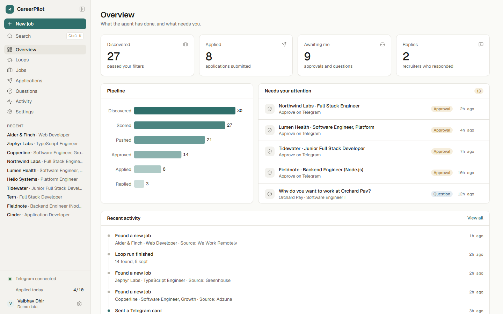
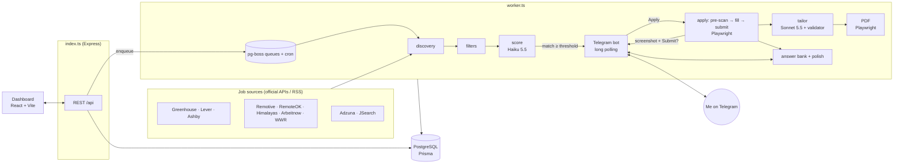
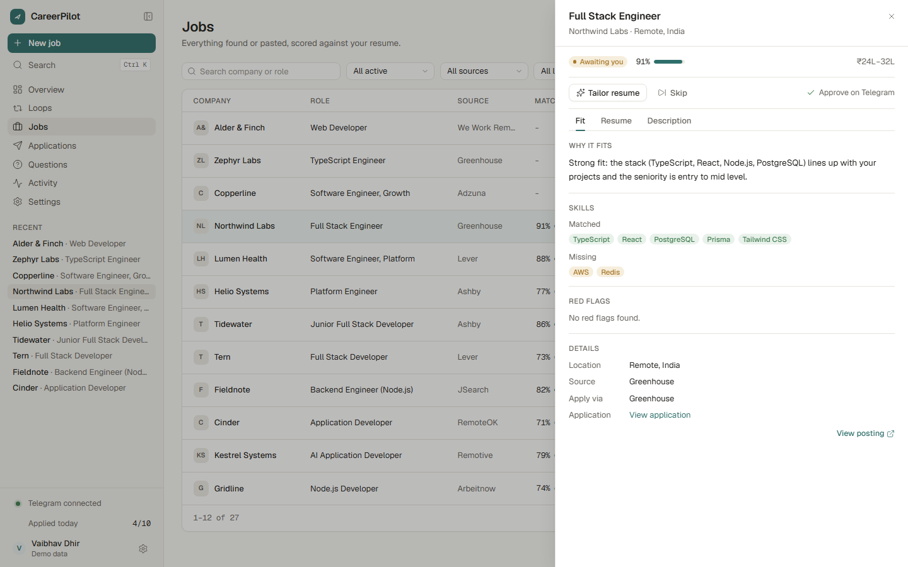
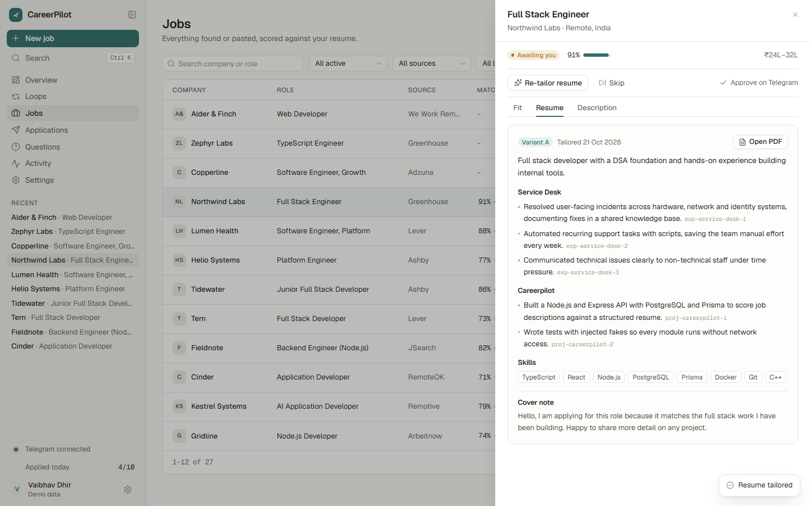
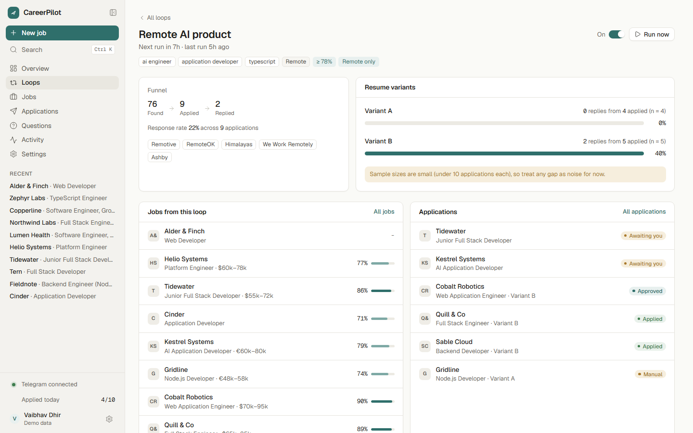
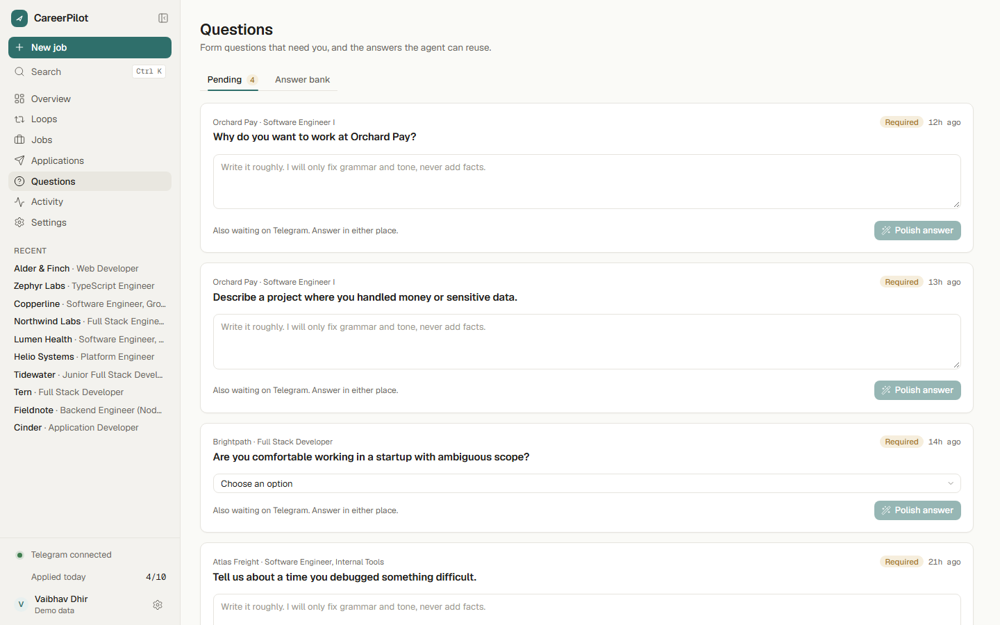
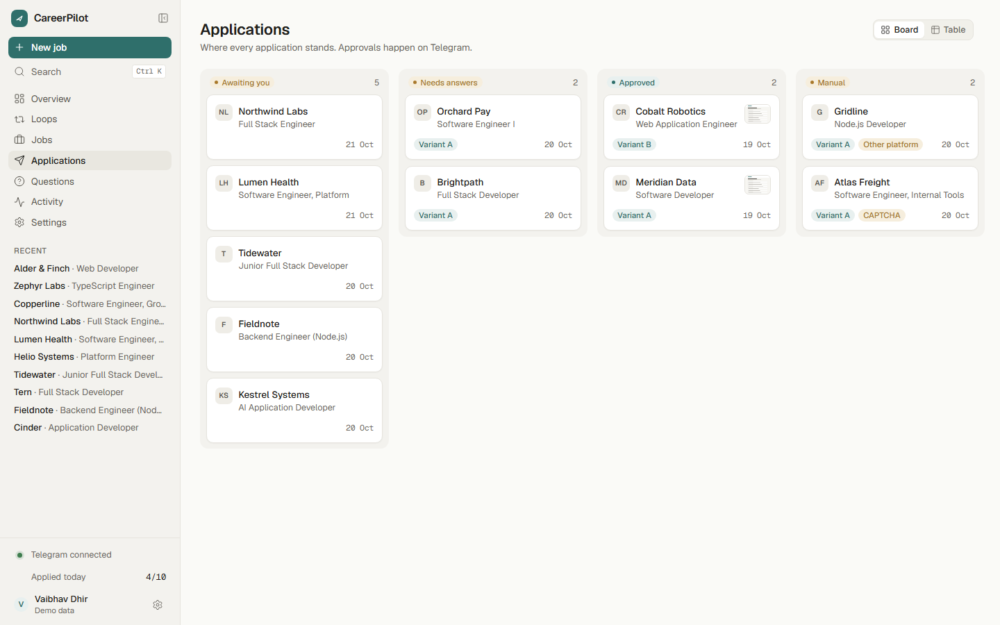
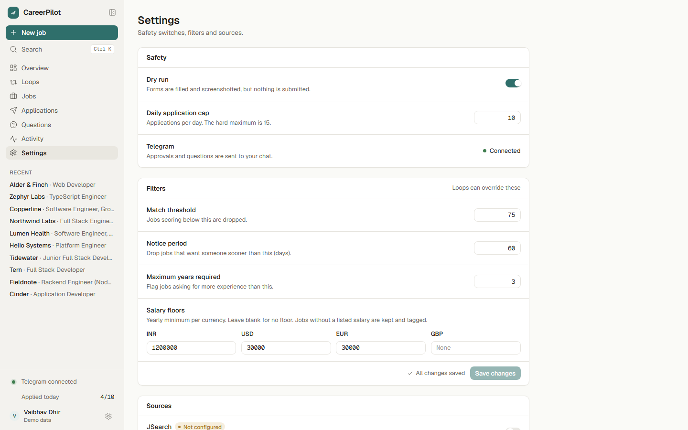

# CareerPilot AI

A personal job-hunting agent with a human in the loop. It finds jobs, scores them against my resume,
tailors the resume for each one, fills the application form, and asks me on Telegram before anything is sent.



**Why not full-auto?** Auto-apply tools get complaints for sending irrelevant applications in bulk.
CareerPilot keeps a human tap on every submit, and filters hard before anything reaches me.

## What it does

| Stage | How |
|---|---|
| **Discover** | Loops (saved searches) run every 6 h on pg-boss and pull from 10 official APIs/feeds: Greenhouse, Lever, Ashby boards, Remotive, Remote OK, Himalayas, Arbeitnow, We Work Remotely, Adzuna, JSearch. I can also paste a JD or URL. Deduped by company + title + URL. |
| **Filter** | Before any AI cost: salary floor per currency, 60-day notice period ("immediate joiners" dropped), seniority titles, loop locations (incl. "Remote - US only"). |
| **Score** | Claude Haiku 5.5, structured output: match %, matched/missing skills, red flags (seniority, location, visa, notice, salary). Capped per day. |
| **Ask me** | Telegram card with `[Apply] [Skip] [View resume]`. |
| **Tailor** | Claude Sonnet 5.5 rewrites and reorders my real bullets. **Code** rejects any bullet whose id isn't in `resume.json`, any changed number, any skill I don't have. Rendered to an ATS-friendly PDF with Playwright. |
| **Form Q&A** | Playwright pre-scans the form first. Known answers come from the answer bank; new questions come to me on Telegram, I reply roughly, Claude fixes grammar only (a code check rejects new facts), I approve. |
| **Apply** | Playwright fills Greenhouse / Lever / Ashby, screenshots, and sends me a "Ready to submit" card. Submit only after a second tap. Anything else (Indeed, Workday, CAPTCHA, unknown form) becomes a **manual** kit: link + tailored PDF + copyable answers. |
| **A/B** | A loop can rotate two base resumes; the dashboard shows response rate per variant. |
| **Dashboard** | Every job, application, question, answer and agent action. |

## Safety (enforced in code, each with tests)

- **Two taps before a real submit:** `[Apply]` starts, `[Submit]` on the filled-form screenshot sends. The REST API has no approve/submit route at all.
- **DRY_RUN on by default:** forms are filled and screenshotted, never submitted. Turning it off needs a confirm dialog.
- **Never double-submits:** atomic `submitLockedAt` lock + unique idempotency key per application; a failed submit is never retried.
- **Max 15 applications/day** (hard cap, whatever the setting says).
- **No invented experience or answers:** tailored bullets must trace to real bullet ids; form answers only from me or approved bank rows.
- **No LinkedIn / Naukri automation**, no scraping: official APIs and feeds only, each source's rate limit from its terms ([DECISIONS.md](docs/DECISIONS.md#job-sources-terms-of-use-checked-2026-10-21)).
- **Every step is logged** as an `AgentAction` (what, when, job, resume version, screenshot).
- Telegram obeys **only my chat** (locked on first `/start`).

## Architecture



- **Two processes:** the API serves the dashboard; the worker runs queue jobs, loop schedules and Telegram polling (only one process may poll Telegram, and Playwright/Claude work never blocks a dashboard request).
- **Contracts first:** `server/src/contracts.ts` holds every status, API shape and module interface, and the web app imports it directly, so both sides can't drift.
- **Injected I/O:** Claude, Telegram, Playwright and HTTP are passed in, so all 316 tests run offline with fakes.

## Stack

React 19 + TypeScript + Tailwind v4 (Vite) · Node.js + Express + TypeScript · PostgreSQL + Prisma 7 · pg-boss ·
Claude API (Haiku 5.5, Sonnet 5.5) · Playwright · Telegram Bot API (grammY) · Vitest + Testing Library · Docker

## Setup

Needs Node 22+, Docker Desktop.

```bash
git clone <repo> && cd careerpilot-ai
cp -n .env.example server/.env       # then fill in the keys you have (see comments inside)
mkdir -p data/private
# -n = don't overwrite files you already have
cp -n data/resume.example.json data/private/resume.json        # replace with your real resume
cp -n data/answers.example.json data/private/answers.json      # your notice period, CTC, links...
cp -n data/target-companies.example.json data/target-companies.json   # optional: companies to watch
npm run setup                        # installs everything, starts Postgres, migrates, seeds
```

Only `ANTHROPIC_API_KEY` is needed to score and tailor. Telegram, Adzuna and JSearch are optional; anything without a key is skipped with a log line.

**Telegram:** message `@BotFather` → `/newbot` → put the token in `TELEGRAM_BOT_TOKEN` → start the app → send `/start` to your bot.

## Run

```bash
npm run dev:all      # Postgres + API (:3000) + worker + dashboard (http://localhost:5173)
npm run demo         # dashboard only, on built-in sample data (no backend, no keys) - for showing it
npm test             # all tests (server + web), no network, no API cost
```

Useful from `server/`: `npm run resume:check` (validate resume.json), `npm run jobs:refilter` (re-apply filters after changing them),
`npm run db:studio` (browse the database).

Telegram commands: `/status`, `/pending`, `/pause [loop]`, `/resume [loop]`.

## Screenshots

| | |
|---|---|
|  Job drawer: score, skills, red flags |  Tailored resume, each bullet tagged with its source id |
|  Loop with resume A/B response rates |  Form questions waiting on me |
|  Applications board |  Dry run, caps, filters, sources |

(Screenshots use demo data.)

## Project layout

```
server/
  src/contracts.ts      shared types (also imported by web/)
  src/index.ts          API process          src/worker.ts   worker process
  src/api/              REST routes          src/queue/      pg-boss pipeline, loop schedules, A/B rotation
  src/discovery/        one adapter per job source
  src/filters/          salary, notice, seniority, location, dedupe
  src/scoring/          Haiku scoring        src/tailor/     Sonnet tailoring + validator
  src/pdf/              resume HTML → PDF    src/apply/      pre-scan, fill, submit gate, manual path
  src/telegram/         bot + cards + Q&A    src/answers/    answer bank, matching, polish
  prisma/               schema, migrations, seed
  tests/                Vitest (unit, API, real-Chromium form tests, e2e)
web/                    dashboard (React, TanStack Query, Radix, motion, Recharts)
docs/                   ROADMAP, DECISIONS, WALKTHROUGH (module-by-module explainer)
data/                   *.example.json templates; data/private/ is gitignored
```

## Docs

- [docs/WALKTHROUGH.md](docs/WALKTHROUGH.md): every module in plain English, with likely interview questions
- [docs/DECISIONS.md](docs/DECISIONS.md): what was chosen and why, plus each job source's terms
- [docs/ROADMAP.md](docs/ROADMAP.md): done / next
